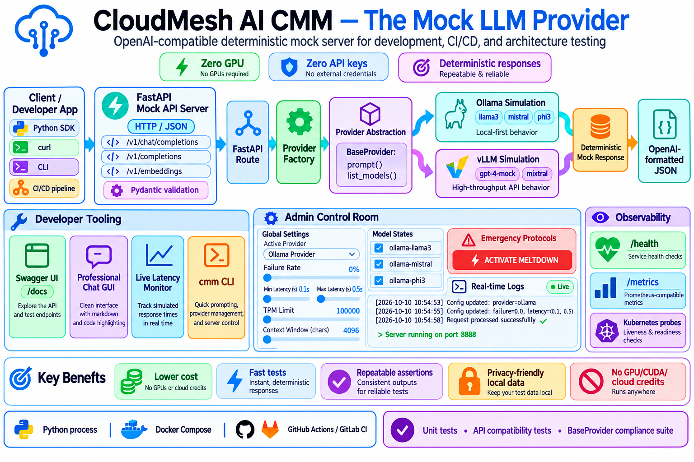
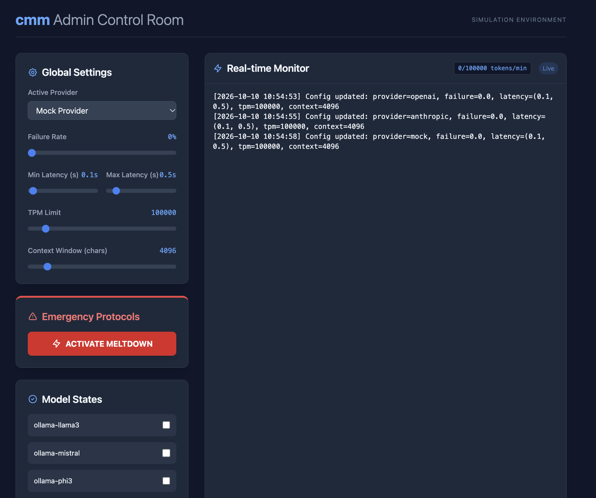

# Cloudmesh AI llm-mock (Mock LLM Provider)



`cloudmesh-ai-llm-mock` is a professional-grade, OpenAI-compatible mock LLM service designed for developers and testers. It allows you to simulate various LLM providers and production-grade failures without needing actual GPU infrastructure or expensive API keys, making it the perfect tool for CI/CD pipelines, local development, and resilience testing.

## Key Features

- **OpenAI-Compatible API**: Implements the standard `/v1/chat/completions`, `/v1/completions`, and `/v1/embeddings` endpoints. Swap real LLM endpoints for this mock server with zero code changes.
- **Multi-Provider Simulation**: High-fidelity simulation of different providers (Ollama, vLLM, Anthropic, Azure OpenAI, AWS Bedrock), including provider-specific response headers and error formats (Quirks).
- **Chaos Engineering Engine**: Test your application's resilience by simulating real-world API instability:

    - **Random Failures**: Inject 429 (Rate Limit) and 500 (Internal Error) responses.
    - **Simulated Latency**: Configure min/max delays to test timeout handling.
    - **TPM & Context Limits**: Simulate Tokens-Per-Minute limits and Context Window overflows.
    - **GPU OOM Simulation**: Restrict which models are "loaded" to simulate memory errors.
    - **The Meltdown Profile**: A one-click catastrophic failure sequence (Latency $\rightarrow$ Total Failure $\rightarrow$ Service Unavailable).
- **Scenario-Based Mocking**: Move beyond static strings. Use keyword-based templates to simulate specific behaviors like **Safety Refusals**, **Hallucinations**, or **Edge-Case Responses**.
- **Dual-Interface GUI**:

    - **User Chat UI** (`/chat`): A polished, real-time markdown chat interface with a live latency monitor.
    - **Admin Dashboard** (`/admin`): A powerful control center to toggle chaos settings, manage loaded models, and edit scenarios in real-time.
- **Observability Mocks**: Includes mock `/health` and `/metrics` endpoints to test Kubernetes probes and monitoring stacks.

## Quick Start

### 1. Installation

```bash
git clone https://github.com/cloudmesh-ai/cloudmesh-ai-llm-mock.git
cd cloudmesh-ai-llm-mock
pip install -e .
```

### 2. Using the Mock Server

Start the server to expose the OpenAI-compatible API:

```bash
cmm serve --port 8888
```

The server is now available at `http://localhost:8888`. 

**Explore the Interfaces:**

- **User Chat UI**: `http://localhost:8888/chat`
- **Admin Dashboard**: `http://localhost:8888/admin`
- **API Documentation**: `http://localhost:8888/docs`

**Example API call:**

```bash
curl http://localhost:8888/v1/chat/completions \
  -H "Content-Type: application/json" \
  -d '{
    "model": "ollama-llama3",
    "messages": [{"role": "user", "content": "Hello!"}]
  }'
```

### 3. Using the CLI

The `cmm` command allows you to interact with the mock providers directly:

```bash
# Send a prompt using the default provider
cmm prompt "What is Cloudmesh AI?"

# Switch the active provider to vLLM
cmm provider set vllm

# List available models for the active provider
cmm list
```

## Mock Provider Matrix

| Provider | Simulated Behavior | Key Models | Implementation |
| :--- | :--- | :--- | :--- |
| **Ollama** | Local-first LLM feel | `llama3`, `mistral`, `phi3` | ✅ Mocked |
| **vLLM** | High-throughput API feel | `gpt-4-mock`, `mixtral` | ✅ Mocked |
| **Anthropic** | Claude-style responses & headers | `claude-3-opus`, `haiku` | ✅ Mocked |
| **Azure OpenAI** | Enterprise API feel & quirks | `gpt-4`, `gpt-35-turbo` | ✅ Mocked |
| **AWS Bedrock** | AWS-style error formats | `titan`, `claude-v2` | ✅ Mocked |

## Docker Deployment

Run the mock server using Docker for an isolated setup:

```bash
# Start the server in the background
docker-compose up -d
```

The server will be available at `http://localhost:8888`. Your configuration is persisted via a volume mount to `~/.config/cloudmesh/` on your host machine.

## Documentation



Detailed guides are available in the following sections:

- [Installation Guide](installation.md)
- [Configuration Guide](configuration.md)
- [CLI Reference](cli.md)
- [Architecture Overview](architecture.md)
- [Chaos Engineering Guide](chaos.md)
- [Scenario Management](scenarios.md)
- [GUI Guide](gui.md)
- [Contributing Guide](contributing.md)

## Testing

The project ensures consistency across mock providers using a tiered testing strategy:

- **Unit Tests**: Verify that each provider returns the expected mock format.
- **API Tests**: Validate the FastAPI routes against the OpenAI API specification.
- **Compliance Suite**: Ensures all mock providers implement the same base interface.

## Contributing

We welcome contributions to add new mock providers or expand the simulated API responses. Please see [Contributing](contributing.md) for guidelines.
